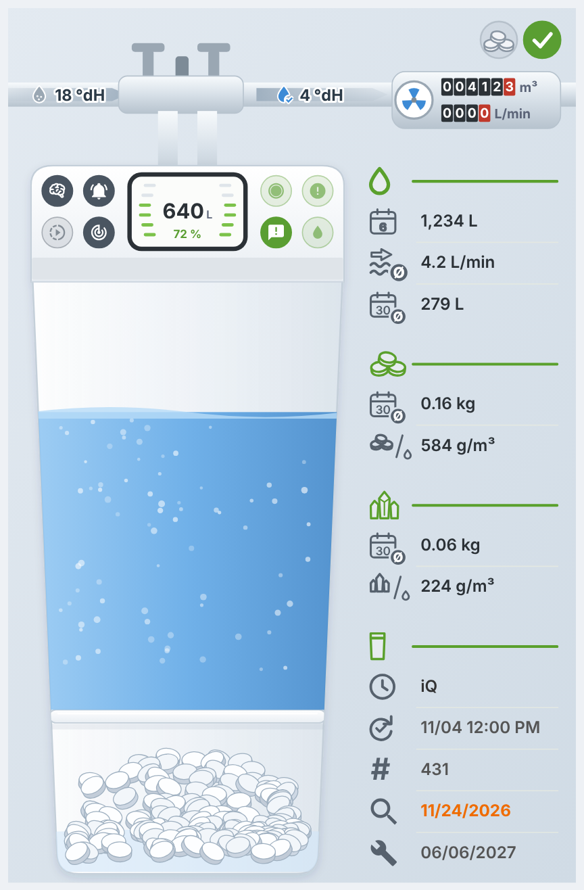
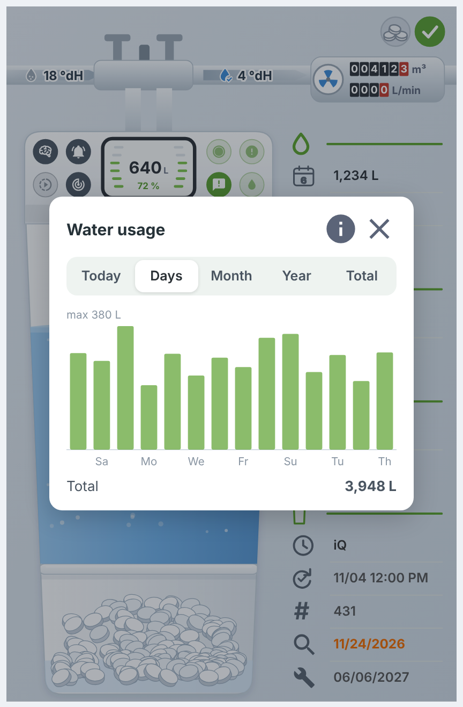
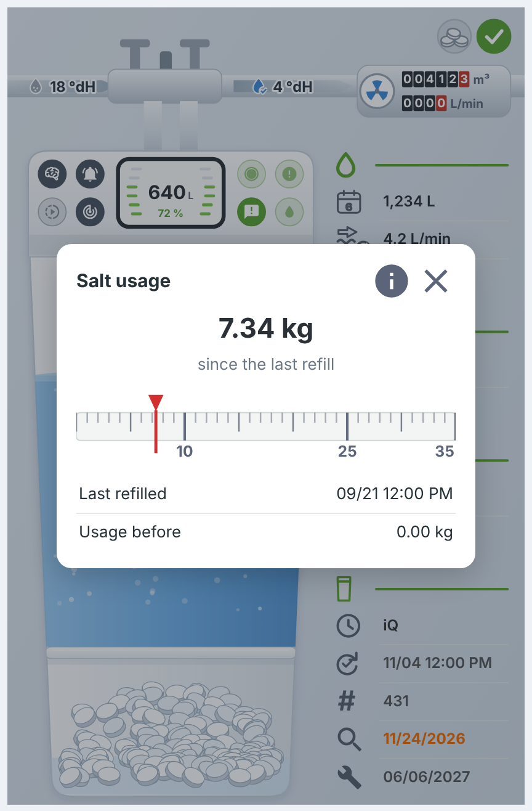
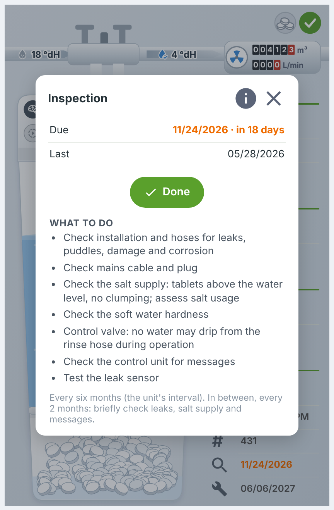
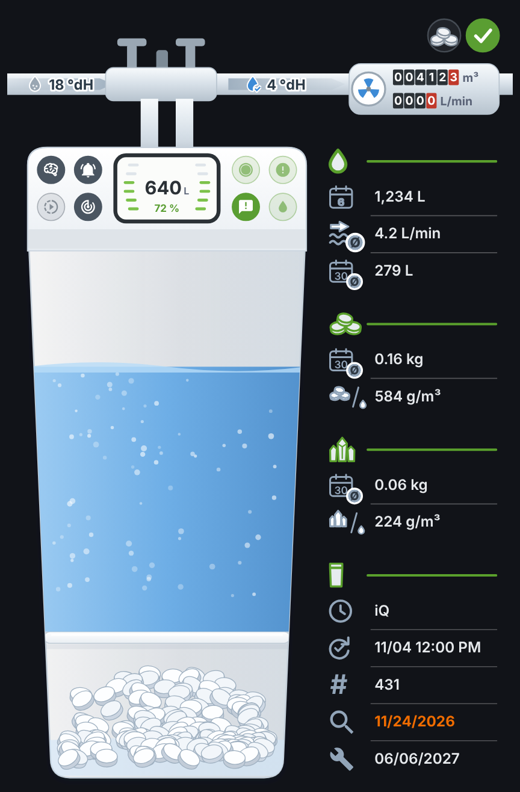

# Dashboard card `custom:gruenbeck-card`

The integration ships its own dashboard card. It is registered automatically: no HACS frontend download, no dashboard resource. After installing or updating the integration, restart Home Assistant and reload the browser once.



## Add the card

Edit a dashboard, **Add card**, search for **Grünbeck softener**. Or in YAML:

```yaml
type: custom:gruenbeck-card
```

With one softener the card needs no configuration. It finds the entities of the integration by their unique id, so renamed entities keep working.

## What it shows

* **Picture of the softener**: resin tank filled to the remaining capacity, salt tablets (one tablet left on a salt warning), display with the remaining capacity in litres and percent, LED strip.
* **Pipe on top**: raw and soft water hardness, a water meter with the total and the current flow. The water in the pipe moves while water flows.
* **Two status lamps**: softener (OK, error, no data change) and salt.
* **Control lid**: the switches of the integration (iQ mode, signal on failure, LED ring options, live mode, regeneration tracking). Switching asks for confirmation.
* **Statistics** on the right: water today, average flow, average per day over 30 days; salt and lime per day and per m³; next regeneration, last regeneration, number of regenerations, next inspection and maintenance.

## Tap to see more

| Tap on | Opens |
|---|---|
| A statistics block or row | Bar charts per day, month, year and in total |
| Water meter, upper counter | Total water usage |
| Water meter, lower counter | Water usage of today (ⓘ shows the flow history) |
| Salt in the tank | Salt used since the last refill on a scale up to 35 kg, last refill |
| Salt lamp | List of the refills with the usage before each one |
| Status lamp | Status window: state, last poll, last data change, link to the [notifications](notifications.md) |
| Last regeneration | Details with the steps of the regeneration |
| Number of regenerations | List of the last regenerations |
| Inspection, maintenance | Due date, what to do (from the manual), "Done" button |

A long press shows a tooltip, e.g. on phones.

| Charts | Salt usage | Inspection | Transparent on a dark dashboard |
|---|---|---|---|
|  |  |  |  |

## Options

All options are in the visual editor, grouped as below. Every option has a help text.

| Group | Option | YAML | Default |
|---|---|---|---|
| General | Device (only needed with several softeners; any device of the softener works) | `device` | found automatically |
| General | Language of the card, also sets number and date format | `language: de` / `en` | language of the user profile |
| Display | Background: blue-grey, light, or transparent (shows the dashboard background; adapts to a dark theme) | `background: tint` / `light` / `transparent` | `tint` |
| Display | Show the control lid with the switches | `show_controls` | `true` |
| Behavior | Ask before switching | `confirm` | `true` |
| Behavior | "Done" for maintenance and inspection possible from this many days before the due date | `service_done_days` | `30` |

YAML only: `entities` replaces an entity the card found by itself, e.g. `entities: {water_today: sensor.my_utility_meter}`.

## Languages

English and German. To add a language, see [card/README.md](../card/README.md).

## How it is built

The card is one JavaScript file without dependencies, drawn as inline SVG. Its source is split into small modules in [`card/`](../card/); the integration only serves the built file `custom_components/gruenbeck_cloud_se/frontend/gruenbeck-card.js`. The card talks to the integration through one websocket command, `gruenbeck_cloud_se/card_info`, which returns per softener the entity ids, the automations made from the notification blueprint and the daily values for the charts.
